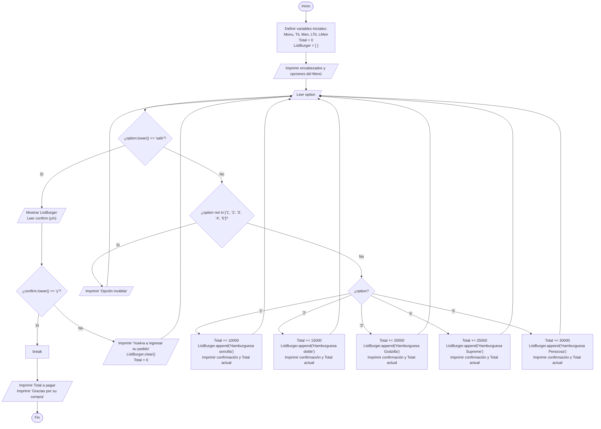
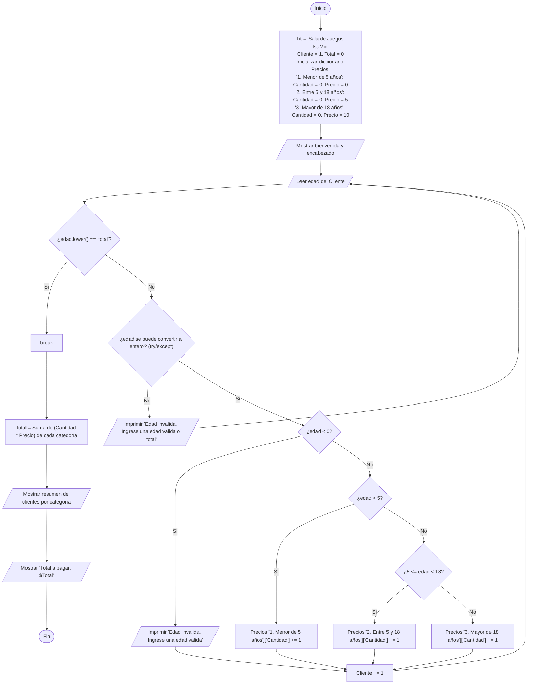
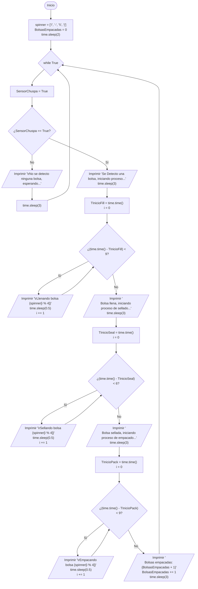

# Parcial 1 Algoritmia y programación

## ¿Que es pseudocódigo y un diagrama de flujo y para que se usan en un contexto de programación?

El pseudocodigo es una manera informal de escribir un algoritmo, similar al lenguaje de programación pero mas en una forma descriptiva que siguiendo la sintaxis extricta de alguno en particular. La idea es que sea comprensible para nosotros los humanos y que describa la lógica de forma clara.

Por otro lado un diagrama de flujo es una manera de hacer algo similar al pseudocodigo pero de forma gráfica, siguiendo paso a paso que es lo que debe hacer el algoritmo.

Sirve para establecer de forma preliminar que es lo que va a realizar un algoritmo, permitiendo el análisis del mismo, la estructuracion de la lógica e incluso verificar la viavilidad de una solución propuesta.

## ¿Qué es un algoritmo?

Un algoritmo es un conjunto ordenado y finito de inatrucciones o pasos para resolver un problema o realizar una tarea.

**un algoritmo tiene ciertas fases:** Descomponer el problema, describir que es lo que se debe hacer, realizar pruebas simples, traducirlo a lenguaje de programación, implementar y realizar pruebas.

## ¿Cuales son los métodos vistos en clase para almacenar datos en python? Diga una aplicación para cada uno de ellos.

Los datos en python se almacenan en variables, pero cambia es el tipo de variable, siendo:

- **Variables Simples (int, float, str, bool):** Estas almacenan un unico valor en memoria a la vez. Sirve para guardar contadores (i=0), acumular valores (Total+=1) o banderas de estado (Sensor=True) 

- **Listas (list):** Son colecciones de elementos que se pueden modificar y se delimitan por llaves [ ]. Generalmente usada como un registro dinamico para almacenar varios datos (Comida.append(...))

- **Tuplas:** Son colecciones de elementos, pero a diferencia de las listas estas no se pueden modificar y estas se delimitan con parentesis ( ). Se usa para guardar datos protegidos que en ningun momento cambiaran, puede ser el caso por ejemplo de constantes en algunos calculos (x,y).

- **Diccionarios:** Son estructuras dinamicas que almacenan pares de informacion en forma de clave-valor, se delimitan por corchetes { }. Se puede relacionar los diccionarios con una tabla en donde los valores tiene nombre (saludo = {'hola' : 'hi'}).

## ¿Quien es Ada Lovelance y porque es importante en la historia de la programación?

Fue una matematica britanica del siglo XIX la cual colaboro con Charles babbage en el desarrollo de una máquina analítica. Es reconocida como la primera persona en desarrolar un programa de computador en la historia. En 1843 documentó el primer algoritmo para ser procesado por una maquina la cual calculaba los numeros de bernoulli usando bucles y especificando las operaciones matemáticas requeridas.

## ¿Que es una CPU, GPU y NPU, que los diferencia y cual es su funcionamiento en un computador?

- **CPU:** Es la unidad central de procesamiento, es el componente principal de un computador el cual interconecta todos los demas componentes y gobierna su funcionamiento.

- **GPU:** Es la unidad de procesamiento grafico, esta se encarga de procesar toda la informacion grafica y mostrarnos una interfaz, basicamente se encarga de renderizar datos

- **NPU:** Es la unidad de procesamiento neuronal, es un procesador especializado en acelerar tareas y algoritmos de inteligencia artificial, aprendizaje automático y redes neuronales artificiales.

Son todos componentes importantes de un computador pero cumplen funciones diferentes, un ejemplo claro es que aunque haya una unidad de procesamiento grafico, esta no puede renderizar si no le llega ningun dato de la CPU, puesto a que esta es la que se encarga de enviarle informacion. Por otro lado las NPU se han estado implementando en procesadores ARM de smarphones enfocados en el ahorro energético a la hora de procesar redes neuronales.

## Ejercicio 1

En una franquicia de comida rápida se necesita implementar un sistema con el cual se pueda
hacer uno o múltiples pedidos. NOTA: Diseñe como mínimo cinco opciones y el menú debe
tener precios razonables para los usuarios.

En caso que el usuario pida algo que no haga parte del menú, sacar un mensaje en donde se
le informe que no hay el pedido y volverle a preguntar. NOTA: Sea creativo con el mensaje
que le va a mostrar al usuario.

### Variables de Entrada y Salida

#### Entradas

- option

#### Salidas

- Total

### Diagrama de Flujo

### Prueba Ejecutada:

Demostrar el correcto funcionamiento del código. Una prueba puede ser: Imagine que va a almorzar usted junto con su pareja la cual va a pedir un plato de los que hay en el menú y su sobrino, que no alcanza a leer las opciones, pide algo que no esta en la lista.

### Explicación:

Este script, lo dividi en tres partes, la primera la cual son los preliminares se encargan de definir variables las cuales van a ser necesarias, como por ejemplo el menu el cual fue diseñado como un diccionario en donde las claves son el elemento del menu y sus valores son los precios respectivos, esto con el fin de facilitar el trabajo al momento de tener que indexar al hacer el calculo del valor total a pagar. Por otro lado lo demas que se encuantra en preliminares son algunos calculos del largo de los strings que se utilizaran para mostrar el menú, esto con el fin de hacerlo mas estético.

La segunda parte, nombrada 'menú', imprime el menu de una forma ordenada y agradable a la vista, un detalle importante es que para poder visualizar el diccionario se debe implementar un ciclo for que recorra todos los pares de datos e imprima la clave y el valor.

Posteriormente, en la seccion llamada 'La magia' se implementa un ciclo while para crear un ciclo infinito por lo menos hasta que el usuario lo desee. Aquí ademas se desencadena una serie de condicionales los cuales nos ayudaran a saber cual es la eleccion del cliente y a partir de ello agregara el valor del diccionario al valor total a pagar. Una vez el usuario finalice la sesion el programa le preguntara que si esta seguro de su pedido, realice esto con el fin de que el cliente pudiera corregir el pedido en caso de alguna equivocación.

Por ultimo el programa imprime el valor total que el cliente debe pagar.

Para las pruebas se implemento el uso de una libreria llamada unittest.mock con su funcion patch. Esta funcion nos permite en este caso realizar entradas automaticas mediante, en este caso, la variable 'input_sequence' las cuales va a tomar los input que se generen y les va a ingresar los datos en el mismo orden que se encuentran en la lista. Al finalizar su ejecucion se podran visualizar los resultados de la prueba.

## Ejercicio 2

Escribir un programa para una empresa que tiene salas de juegos para todas las edades y
quiere calcular de forma automática el precio que debe cobrar a sus clientes por entrar. El
programa debe preguntar al usuario la edad del cliente y mostrar el precio de la entrada. Si
el cliente es menor de 5 años puede entrar gratis (es decir que el valor de la entrada es $0),
si tiene entre 5 y 18 años debe pagar $5 y si es mayor de 18 años, $10.

### Variables de Entrada y Salida

#### Entradas

- edad

#### Salidas

- Total

### Diagrama de Flujo

### Explicación

Este script esta dividido, igual que el anterior en tres partes. La primera parte nombrada 'Preliminares' realiza algunos calculos de longitud de strings para poder organizar de mejor manera lo que se le va a mostrar al usuario, ademas de ello crea la base de datos en un diccionario usando una tecnica particula la cual consiste en añadir no un valor a una clave sino unos atributos mediante otro diccionario, en este caso contiene el valor de cada edad y almacena el numero de personas que entran a esta categoria los cuales fueron ingresado al programa.

En la sección de bienvenida simplemente se imprimen los mensajes de bienvenida.

En la parte llamada 'La magia' se encuantra el ciclo principal, en donde el usuario debera ingresar manualmente las edades de las persona que entren a la sala de juegos. Alli ademas se encuentran los condicionales que clasifican a cada persona segun la edad comparando el dato ingresado con los datos de la base de datos inicial que se creo en el diccionario y ademas añadiendo un conteo a uno de los atributos del diccionario para saber a cuantas personas de esa categoria se estan ingresando. Finalmente al pedir el total, el script calculara el total mediante los atributos guardados que se encuentran en el diccionario e imprimiendo el total que deben pagar los clientes.

Para las pruebas se implementa la misma libreria y tecnica que en el ejercicio anterior (unittest.mock, patch).

## Ejercicio 3

Diseñe una máquina de arroz para una empresa que debe estar en funcionamiento constante
por largos periodos de tiempo. La máquina debe verificar si hay una bolsa, para después vaciar
el arroz en dicha bolsa, y una vez terminado ese proceso sellarla, para después empacarla en
una caja para su distribución.

### Variables de Entrada y Salida

#### Entradas

- SensorChuspa

#### Salidas

- BolsasEmpacadas

### Diagrama de Flujo

### Explicación

Este script es bastante interesante puesto que decidi hacerlo interactivo para que el usuario pueda tener una nocion mas fiel a la realidad de lo que esta suceciendo. Plantee el script con un enfoque tipo Ladder pero sin implementar todos los condicionales que esto conlleva, es decir, solo estamos implementando un sensor y considerando un entorno ideal en donde no se deben considerar muchas cosas.

Se implemento un ciclo infinito, considerando que el sensor de la presencia de bolsa siempre va a detectar, y una vez lo haga va a empezar el proceso. Se usa la libreria 'time' y dos de sus funciones las cuales son sleep() y time(). La función sleep() pausa el script en la linea en segundos segun el entero que se escriba entre su parentesis y la funcion time() toma una camputa del tiempo actual del pc basandose en el UTC. Mediante ciclos while anidados se generan las animaciones que ayudaran a ver mas interactivo el procedimiento de la maquina.