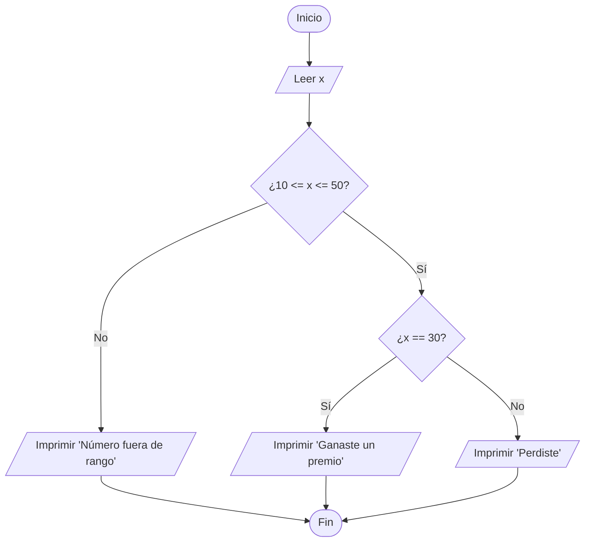
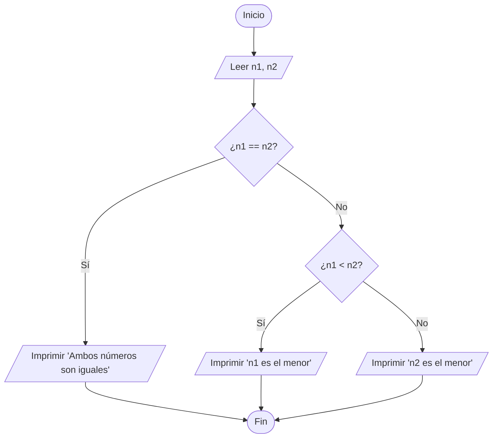
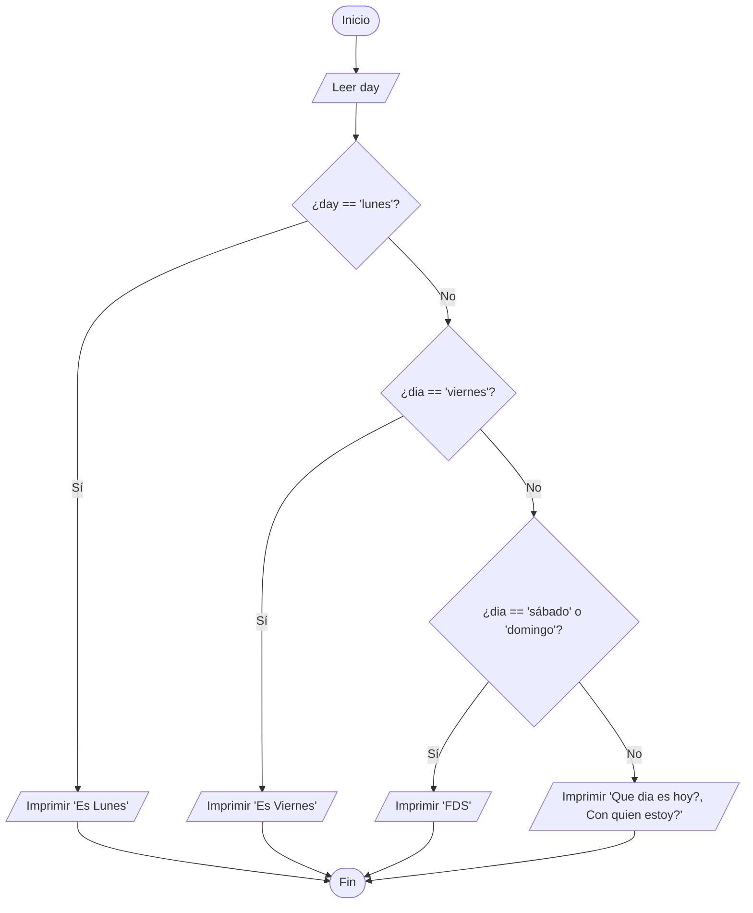
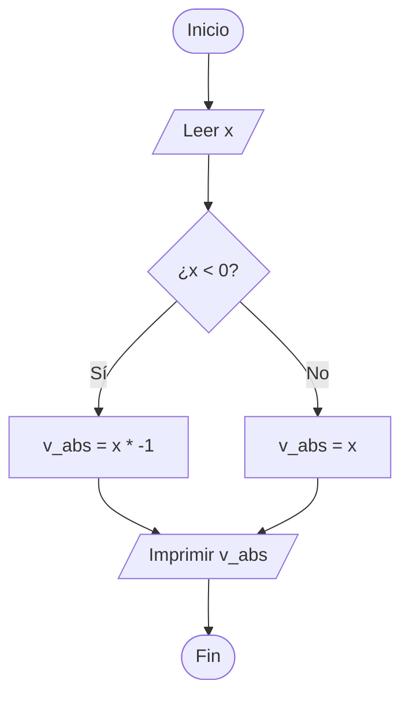
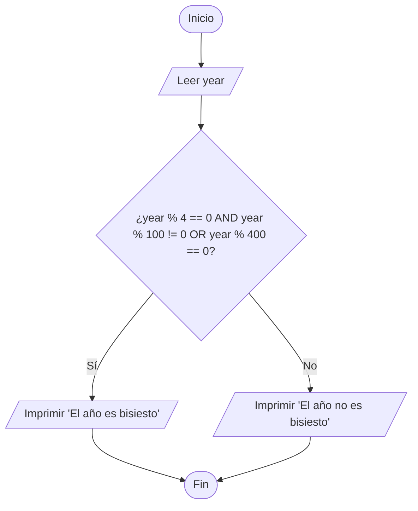
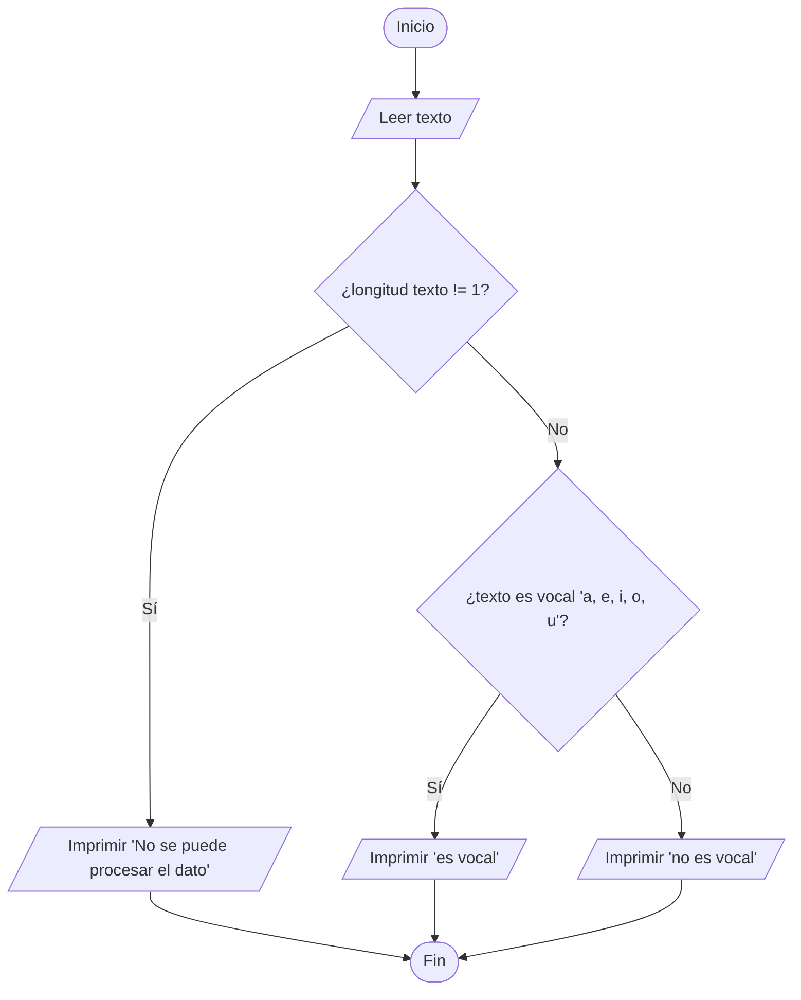
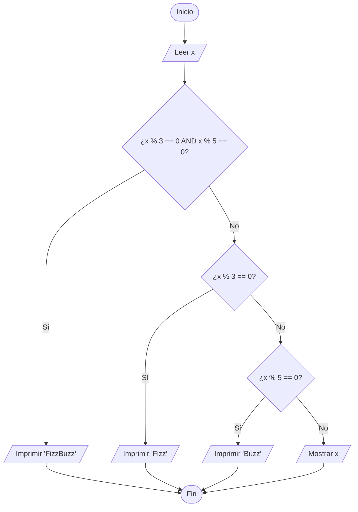
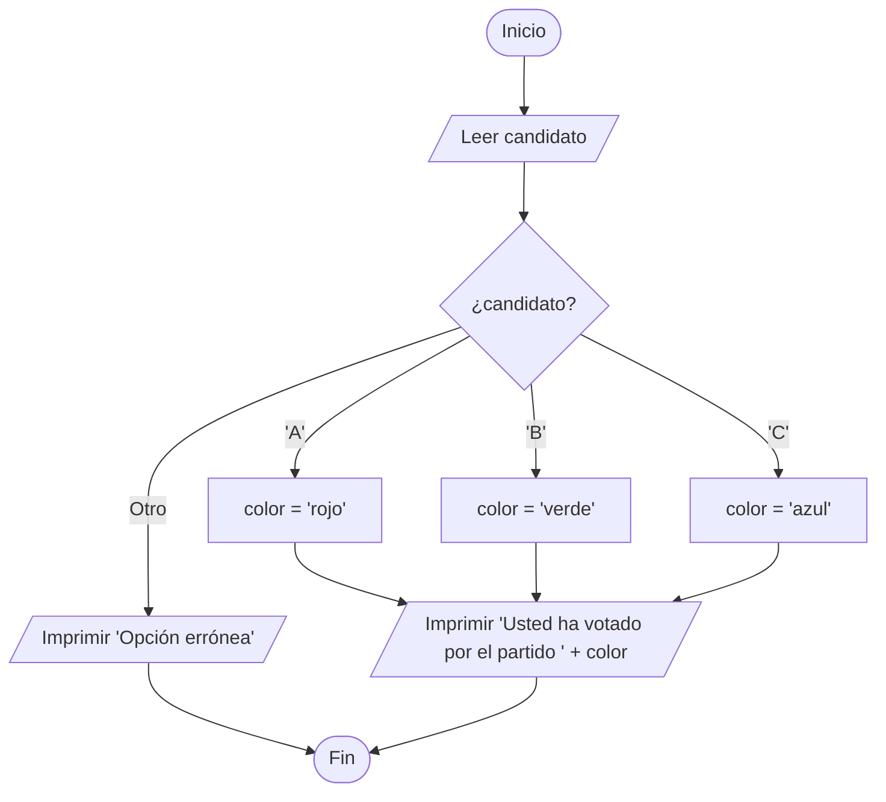
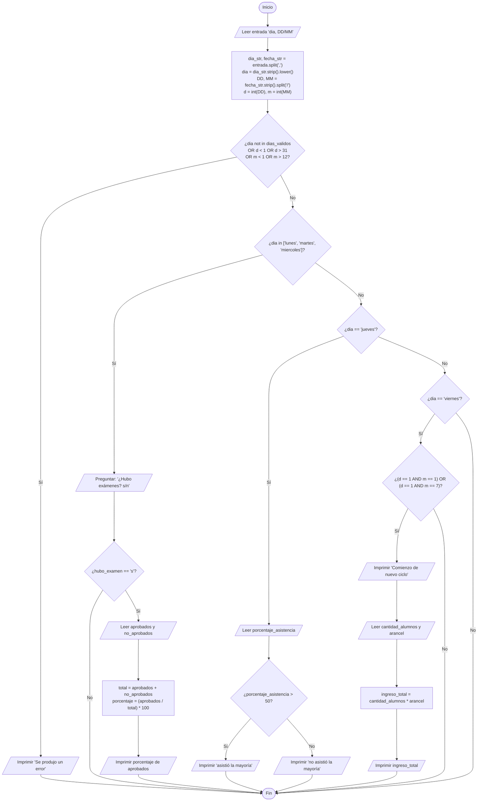

# Taller Diagramas de Flujo y Condiconales

## Ejercicio 1

Solicitar al usuario un número que este entre 10 y 50. Si el número es el 30, imprimir “Ganaste un premio” en el caso contrario “Perdiste”. ¿Qué pasaría si el usuario ingresa -10?

### *Respuesta:*

No cumple el rango esperado y por lo tanto el script devolverá 'Número fuera de rango'.

### Diagrama de Flujo

---

## Ejercicio 2

Solicitar al usuario que ingrese dos números y mostrar cuál de los dos es menor. Dado el caso que ambos sean iguales indicar que los dos son iguales.

### Diagrama de Flujo

---

## Ejercicio 3

Preguntar al usuario que ingrese un día de la semana e imprimir un mensaje si es lunes, otro mensaje diferente si es viernes, otro mensaje diferente si es sábado o domingo. Si el día ingresado no es ninguno de esos, imprimir otro mensaje.

### Diagrama de Flujo

---

## Ejercicio 4

Escribir un programa que, dado un número entero, muestre su valor absoluto. Nota: para los
números positivos su valor absoluto es igual al número (el valor absoluto de 52 es 52), mientras que, para los negativos, su valor absoluto es el número multiplicado por -1 (el valor absoluto de -52 es 52).NOTA: Para este caso no puede utilizar la función abs().

### Diagrama de Flujo

---

## Ejercicio 5

Hacer un programa que permita saber si un año es bisiesto. Para que un año sea bisiesto debe ser divisible por 4 y no debe ser divisible por 100, excepto que también sea divisible por 400.

### Diagrama de Flujo

---

## Ejercicio 6

Escribir un programa que solicite al usuario una letra y, si es una vocal, muestre el mensaje “es vocal”. Se debe validar que el usuario ingrese sólo un carácter. Si ingresa un string de más de un carácter, informarle que no se puede procesar el dato.

### Diagrama de Flujo

---

## Ejercicio 7

Crear un programa en el cual al momento de ingresar un número. Si este número es múltiplo de 3 debe se sacar Fizz, si el número es múltiplo de 5 debe de sacar Buzz y en caso de que sea múltiplo de 3 y 5 sacar FizzBuzz,

### Diagrama de Flujo

---

## Ejercicio 8

Crear un programa que permita al usuario elegir un candidato por el cual votar. Las posibi-
lidades son: candidato A por el partido rojo, candidato B por el partido verde, candidato C por el partido azul. Según el candidato elegido (A, B ó C) se le debe imprimir el mensaje “Usted ha votado por el partido [color que corresponda al candidato elegido]”. Si el usuario ingresa una opción que no corresponde a ninguno de los candidatos disponibles, indicar “Opción errónea”.

### Diagrama de Flujo

---

## Ejercicio 9

Un instituto de enseñanza de inglés necesita un programa que le permita, cada día, procesar observaciones sobre las clases de ese día. El instituto dicta clases a estudiantes de distintos niveles y cada nivel tiene clases en un día de la semana diferente: los lunes se dicta el nivel inicial, los martes el nivel intermedio, los miércoles el nivel avanzado, los jueves son para práctica hablada y los viernes se dicta inglés para viajeros. Se debe comenzar por solicitar al usuario que ingrese la fecha actual en formato “día, DD/MM”, donde [día] es un día de la semana, DD es el número de día y MM es el número de mes. Si el usuario ingresa un día de la semana inexistente o una fecha cuyo día supere el número 31 o el mes supere el número 12, finalizar el programa indicando que se produjo un error. Debe permitirse que ingrese el día de la semana en minúsculas o mayúsculas indistintamente. Como precondición se tiene que lo ingresado por el usuario tendrá la forma <[alfanumérico], [numérico]/[numérico]>. Una vez indicada la fecha, el usuario necesita poder indicar si ese día se tomaron exámenes, pero eso sólo si se trata de los niveles inicial, intermedio o avanzado, ya que las prácticas habladas y el inglés para viajeros no tienen exámenes. Si hubo exámenes, el usuario ingresará cuántos alumnos aprobaron y cuántos no, y el programa le mostrará el porcentaje de aprobados. Si el día fue el correspondiente a práctica hablada, el usuario deberá ingresar el porcentaje de asistencia a clase y el programa le indicará “asistió la mayoría” en caso de que la asistencia sea mayor al 50 % o “no asistió la mayoría” si no es así. Si se trata del inglés para viajeros y la fecha actual corresponde al día 1 del mes 1 o del mes 7, se deberá imprimir “Comienzo de nuevo ciclo” y solicitar al usuario que ingrese la cantidad de alumnos del nuevo ciclo y el arancel en $ por cada alumno, para luego imprimir el ingreso total en $.

### Diagrama de Flujo

---