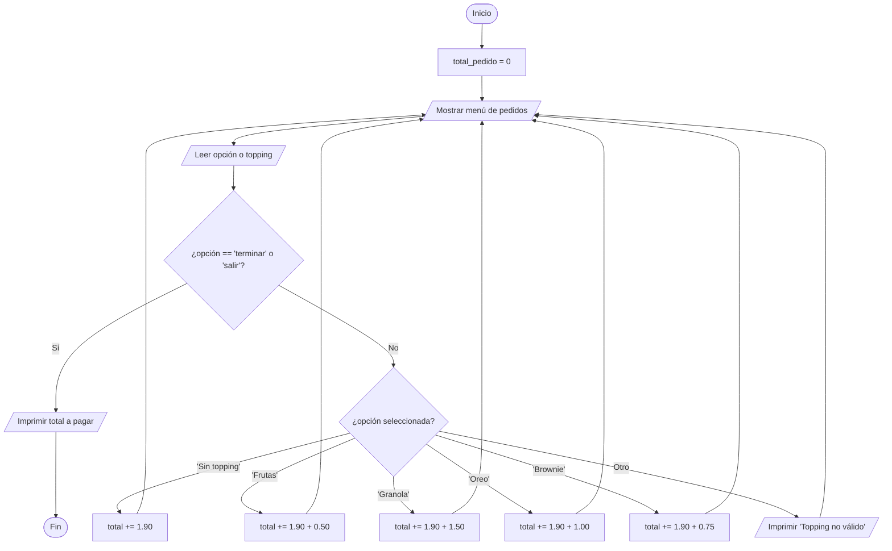
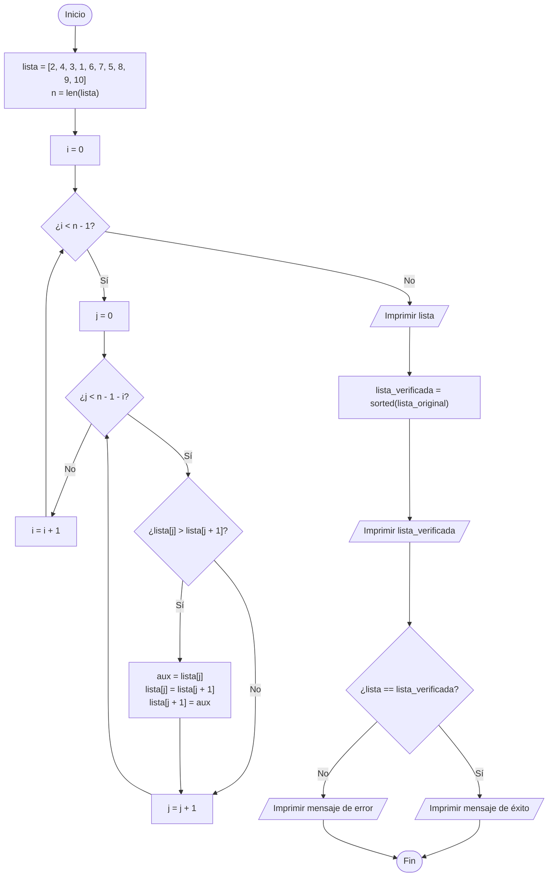
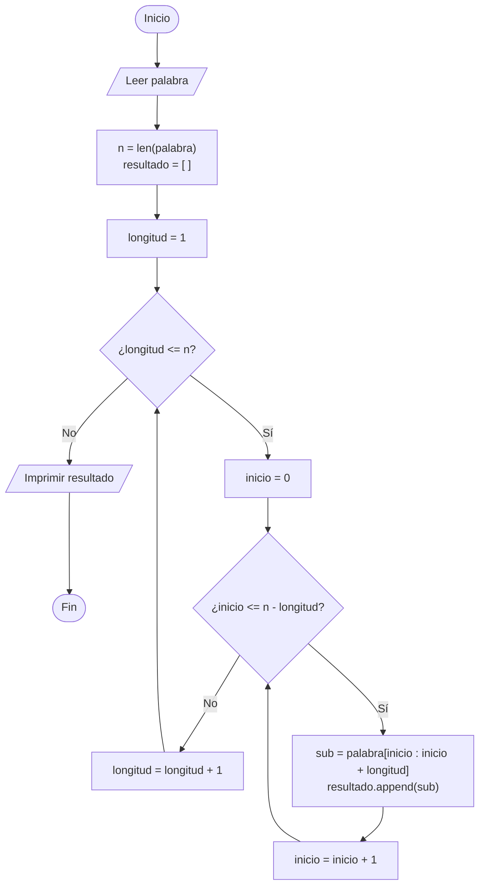
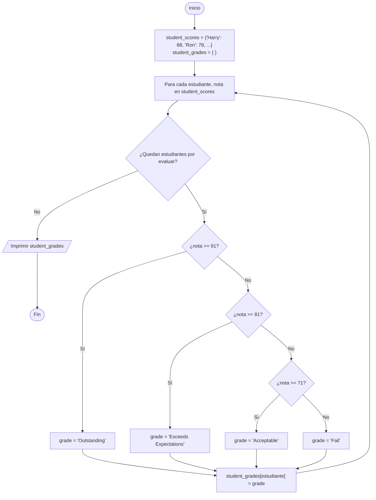
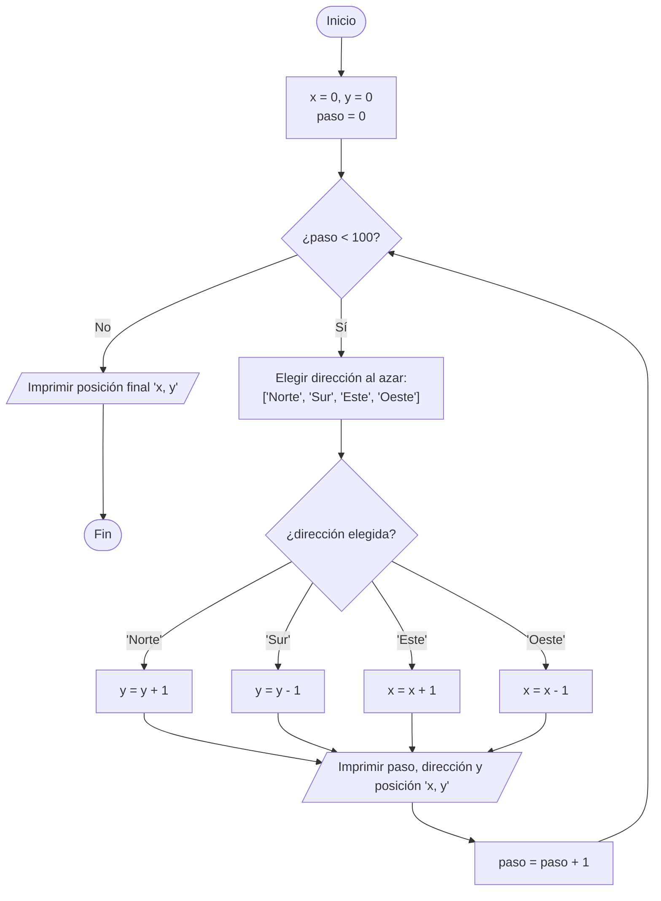

# Taller de Ciclos

### Ejercicio 1

Escribir un programa para el siguiente problema: Un usuario quiere comprar un helado en una conocida marca de comida rápida y desea saber cuánto le costará en función del topping que elija. **NOTA**: Puede escoger o no un topping. Si desea topping, solo puede seleccionar uno.

|||
|---|---|
|Helado sin topping|$1.90|
|Topping de Frutas|$0.50|
|Topping de Granola|$1.50|
|Topping de Oreo|$1.00|
|Topping de Brownie|$0.75|

En caso de que el usuario pida un topping que no se encuentra en el menú, sacar un mensaje en donde se le informe que no hay el topping solicitado. Para finalizar agregar el valor final que debe pagar el usuario si se al momento de hacer uno o varios pedidos. **NOTA**: Sea creativo con el mensaje que le va a mostrar al usuario.

#### Diagrama de flujo

### Ejercicio 2

Escriba un programa para que la siguiente lista [2,4,3,1,6,7,5,8,9,10] se ordene de menor a mayor (orden ascendente). Implementar con ciclos y posteriormente usar una función predeterminada de Python para verificar el funcionamiento del mismo.

#### Diagrama de flujo

### Ejercicio 3

Escriba un programa que lea una palabra e imprima todas las subcadenas, ordenadas por longitud. Por ejemplo, si el usuario introduce “rum”, el programa imprime:

r  
u  
m  
ru  
um  
rum  

#### Diagrama de flujo

### Ejercicio 4

Usted tiene acceso a la base de datos de “student_scores” en un formato de diccionario donde las llaves son los nombres de los estudiantes y los valores son las notas de ellos.

Al finalizar el programa, se debe tener un diccionario denominado “student_grades”, que contiene los nombres de los estudiantes como llaves y los siguientes mensajes como valores:

|||
|---|---|
|Harry|88|
|Ron|78|
|Hermione|95|
|Draco|75|
|Neville|60|

- Scores 91 - 100: Grade = “Outstanding”
- Scores 81 - 90: Grade = “Exceeds Expectations”
- Scores 71 - 80: Grade = “Acceptable”
- Scores 70 or lower: Grade = “Fail”

#### Diagrama de flujo

### Ejercicio 5

Un borracho se desplaza por una ciudad que tiene distribución de calles tipo Manhattan (cuadrícula de calles y carreras) y elige al azar hacia dónde ir al llegar a cada intersección.

Puede elegir al azar entre una de cuatro direcciones. Se podría pensar de manera equivocada que en promedio el borracho no se desplaza mucho de su posición inicial porque las elecciones se anulan estadísticamente entre sí, pero en realidad no es así. Represente las ubicaciones como pares ordenados enteros (x, y) e implemente un programa que muestre el paseo del borracho después de recorrer 100 intersecciones, comenzando en (0, 0), e imprima la ubicación final.

#### Diagrama de flujo

